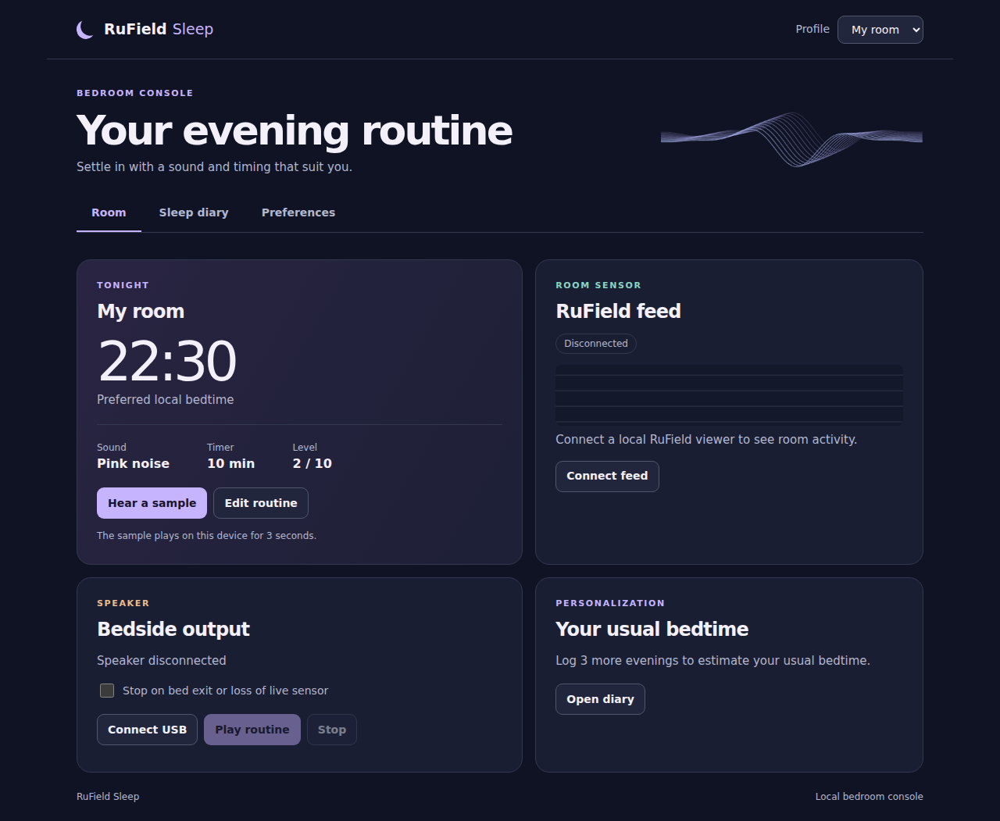

# RuField Sleep

A local bedroom console for people who want to tune when their wind down begins and how long their speaker plays. Connect an ESP32 room sensor through RuView and RuField, pair a USB speaker, and keep a separate diary for each person. The first run opens an empty diary and offers a three second pink noise sample on the computer.

**[Open the management UI](https://ruvnet.github.io/rufield-sleep/)** to try a profile, log an evening, apply a bedtime suggestion, or play timed pink noise on your device. The browser edition keeps its diary in this tab. In Preferences, select **Download diary** to keep a copy or **Restore diary** to load it again. Real ESP32 sensing and speaker control run in the local console below. The two editions keep separate records.



## Run the console

Requires Python 3.10 or newer. The console and browser audio preview use the standard library and browser APIs. USB speaker control supports Linux and macOS.

```sh
git clone https://github.com/ruvnet/rufield-sleep
cd rufield-sleep
python3 app.py
```

Open **http://127.0.0.1:8787**. In **Preferences**, create a profile and choose a bedtime, duration and sound level. In **Room**, select **Hear a sample**. After connecting a speaker, **Play routine** starts the saved timer. A duration of zero saves a silent routine.

## Learn a personal routine

Log the actual bedtime, minutes of sound used and comfort rating in **Sleep diary**. Three distinct evenings unlock a bedtime suggestion. It uses up to 14 recent logged evenings and handles times on either side of midnight. When times are scattered, the console withholds the suggestion. Three evenings rated 4 or 5 out of 5 also unlock a suggested sound duration. Select **Apply suggestion** to change the routine. The console does not change volume automatically.

For a quick check, log **23:55**, **00:05** and **00:10** on three dates in a new profile. The suggested bedtime should be **00:05**. The preferred bedtime should change only after you apply it.

## What the sensors contribute

The console consumes the upstream RuField viewer's public event stream. When a production viewer reports a recent high confidence presence observation, the diary can prefill its time. The person confirms whether that was their bedtime. Select **Stop on bed exit or loss of live sensor** to end playback on a new high confidence bed exit inference, a stale feed or a frame with no verified observations. The user starts playback explicitly. Room activity cannot identify which person was present in a shared bedroom.

| Input | Console behavior |
| :--- | :--- |
| Synthetic viewer | Display event counts tagged Synthetic |
| Captured replay | Display verified counts tagged Replay |
| Production viewer | Display verified counts, offer confirmed presence time and enable the optional speaker guard |
| Missing or stale source | Display Disconnected and clear usable observations |

[Hardware setup, wiring and bench acceptance](docs/hardware.md) · [Design and privacy](docs/design.md)

## Scientific scope

This is a preference and ambient sound project. The speaker plays a user initiated pink noise wind down. The MIT experiment synchronized 50 millisecond noise bursts to EEG slow wave peaks and measured cerebrospinal fluid movement. This console measures neither EEG phase nor fluid flow. It makes no claim about sleep stages, waste clearance or a therapeutic effect. [Research abstract](https://www.rle.mit.edu/pink-noise-restorative-sleep)

## Development

```sh
python3 -m unittest discover -s tests -v
node --check web/app.js
```

CI also compiles the ESP32 S3 firmware against Arduino ESP32 core 3.3.2. Contributions should identify which checks used simulation, a serial emulator or measured hardware. Open an issue with board model, firmware version, expected behavior and steps to reproduce. Leave personal sleep logs out of public reports.

Released under the [MIT License](LICENSE).
