# RuField Sleep

[](https://ruvnet.github.io/rufield-sleep/)

Set a bedtime, try pink noise, and use your own evening diary to choose how long the sound plays. Start in a browser. If you have ESP32 equipment, the local console can also use room observations to help you log bedtime and stop the speaker when you get out of bed.

**[Open the live console](https://ruvnet.github.io/rufield-sleep/)** and select **Room → Hear a sample** for three seconds of pink noise. For a longer session, set the duration in **Preferences**, then select **Room → Play routine**.

## Choose your setup

| | Browser console | Local console |
| :--- | :--- | :--- |
| Get started | Open GitHub Pages on your phone or computer | Run `python3 app.py` with Python 3.10 or newer |
| Play sound | Samples and timed routines use your device speaker | Samples use your browser. Timed routines use a connected ESP32 speaker |
| Keep your diary | Entries survive a reload in the same tab. Before closing it, choose **Preferences → Download diary**. Use **Restore diary** to bring the plain text JSON file back | Each profile's entries are saved in SQLite on the host |
| Connect sensors | Use the hardware setup link to switch to the local console | Connect a RuField viewer fed by an ESP32 sensor through RuView |

The two editions keep separate diaries. Set the duration to zero for a silent routine.

<details>
<summary>See the local console</summary>


</details>

## Try a bedtime suggestion

1. In **Preferences**, create a profile. In **Sleep diary**, log three different evenings. Enter your actual bedtime, minutes of sound used, and a comfort rating for each.
2. To see how the console handles midnight, try **23:55**, **00:05**, and **00:10**. The **Room** tab should suggest **00:05**. If all three evenings used **8 minutes** of sound and earned a comfort rating of **4 or 5**, it should also suggest **8 minutes**.
3. Select **Apply suggestion** when you want to change your routine. The speaker level stays under your control.

The console considers your 14 most recent logged evenings and withholds a bedtime suggestion when the times are too scattered. A duration suggestion needs at least three evenings you rated comfortable.

## Run with ESP32 hardware

The local console uses the Python standard library. USB speaker control supports Linux and macOS.

```sh
git clone https://github.com/ruvnet/rufield-sleep.git
cd rufield-sleep
python3 app.py
```

Open [the local console](http://127.0.0.1:8787/) for the diary and browser sound sample. When the speaker board is flashed and connected, restart the console with its serial port, for example `python3 app.py --speaker /dev/ttyACM0` on Linux. Select **Connect USB**.

Use one RuView compatible ESP32 board for room sensing and a separate ESP32 S3 with an I2S amplifier for sound. With a live RuField feed, you can confirm a recent room presence time as your bedtime. You can also opt to stop playback on a bed exit or loss of verified sensor data. In a shared room, the person using the diary decides whether the observation was theirs.

[Wiring, firmware and sensor setup](docs/hardware.md) · [Data handling and design](docs/design.md) · [Physical bench checks](https://github.com/ruvnet/rufield-sleep/issues/1)

## Research and verification

RuField Sleep plays user initiated pink noise and learns routine preferences from diary entries. The MIT study timed individual sound bursts to peaks measured by EEG and observed changes in cerebrospinal fluid waves. This project has no EEG or fluid flow measurement. [Read the study abstract](https://www.rle.mit.edu/pink-noise-restorative-sleep).

Run the console tests from the repository root.

```sh
python3 -m unittest discover -s tests -v
```

CI also checks the browser UI at desktop and mobile widths, exercises the upstream RuField simulator, and compiles the ESP32 S3 speaker firmware. Physical sound levels and stop latency are tracked in the bench checks above. When reporting a hardware issue, include the board model, firmware version and steps to reproduce. Keep personal diary entries out of public reports.

[Console and firmware CI](https://github.com/ruvnet/rufield-sleep/actions/workflows/verify.yml) · [Pages deployment](https://github.com/ruvnet/rufield-sleep/actions/workflows/pages.yml) · [MIT License](LICENSE)
